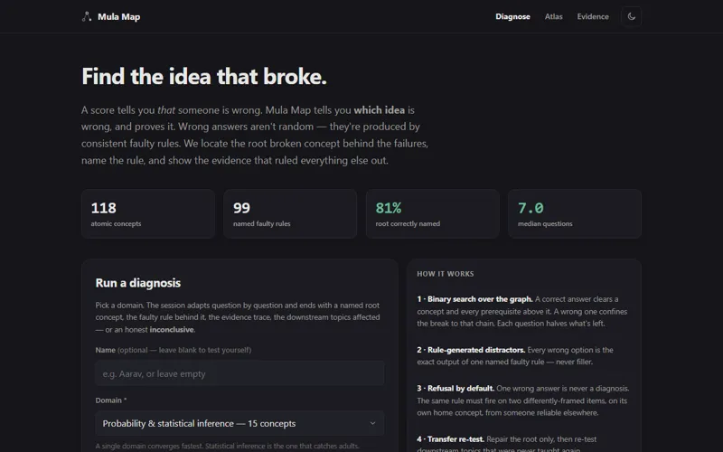
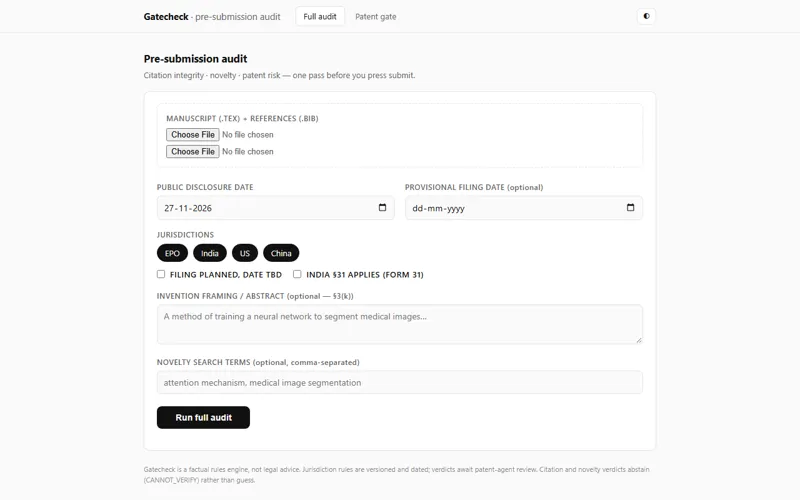
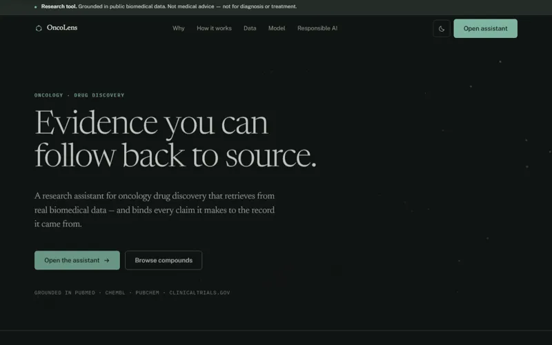
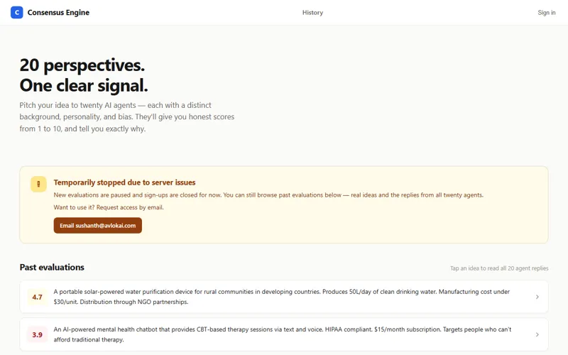
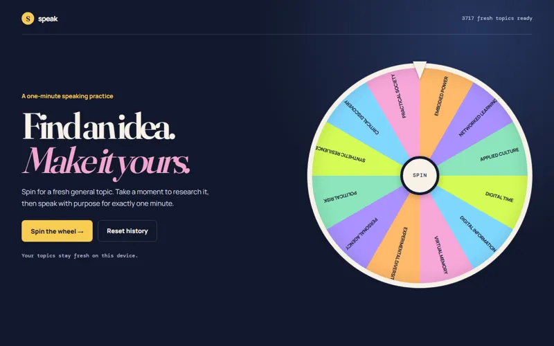

<picture>
  <source media="(prefers-color-scheme: dark)" srcset="assets/banner-dark.svg">
  
</picture>

# Sushanth Kasturi

Founder of [AvlokAI](https://avlokai.com), based in Hyderabad. Studying Cognitive Systems at Loyola Academy, with a diploma in Ethical Hacking & Digital Forensics.

I build AI systems that do useful work: agents, retrieval, automations and developer tools. I came from VAPT, SOC operations and forensics, so I build like someone who will be asked to prove it works. Scoped access, observable systems, explicit failure modes, and an honest "I don't know" when the evidence isn't there.

## Projects

<table>
<tr>
<td valign="top" width="30%"></td>
<td valign="top" width="45%"><b><a href="https://mula-map.avlokai.com/">Mula Map</a></b> A score tells you that someone is wrong. Mula Map tells you which idea is wrong, and proves it. It traces wrong answers back through a prerequisite graph to the misconception that produced them, and refuses to diagnose without evidence.</td>
<td valign="top" width="25%"><b>118 concepts, 99 named faulty rules</b>  <b>81% of root misconceptions correctly named</b></td>
</tr>
<tr>
<td valign="top"></td>
<td valign="top"><b><a href="https://gatecheck.avlokai.com">Gatecheck</a></b> One pass before you press submit. Audits a research manuscript from its <code>.tex</code> and <code>.bib</code> for citation integrity, novelty and patent-risk signals.</td>
<td valign="top"><b>Deterministic, jurisdiction-aware patent rules</b>  <b>Returns <code>CANNOT_VERIFY</code> instead of guessing</b></td>
</tr>
<tr>
<td valign="top"></td>
<td valign="top"><b><a href="https://oncolens.avlokai.com">OncoLens</a></b> A research assistant for oncology drug discovery that binds every claim it makes to the record it came from.</td>
<td valign="top"><b>Grounded in PubMed and ChEMBL</b>  <b>Identifier-first retrieval</b></td>
</tr>
<tr>
<td valign="top"></td>
<td valign="top"><b><a href="https://consensus.avlokai.com/">Consensus Engine</a></b> Twenty agents with different backgrounds, personalities and biases each judge the same idea, independently.</td>
<td valign="top"><b>20 independent perspectives per idea</b></td>
</tr>
<tr>
<td valign="top"></td>
<td valign="top"><b><a href="https://speak.avlokai.com">Speak</a></b> One topic. One minute. No retries. Speaking practice built around unfamiliar prompts that never repeat.</td>
<td valign="top"><b>A timer you can't cheat by switching tabs</b></td>
</tr>
<tr>
<td valign="top" colspan="2"><b>SOC Lab</b> A blue-team lab I built for monitoring and incident-response practice: Wazuh, Suricata, ELK, VirusTotal enrichment and Python response automation.</td>
<td valign="top"><b>2nd of 300+ at ABP Infocom CTF</b></td>
</tr>
</table>

## Small tools

Single-purpose security and CS tools, each one tested and documented. Named in Sanskrit.

<b>Security CLIs:</b> [netra](https://github.com/Linuxboii/netra) (SSH brute-force watcher) · [rahasya](https://github.com/Linuxboii/rahasya) (secrets scanner) · [kavach](https://github.com/Linuxboii/kavach) (security header grader) · [mula](https://github.com/Linuxboii/mula) (DNS and email-security recon) · [prakash](https://github.com/Linuxboii/prakash) (TLS inspector) · [sutra](https://github.com/Linuxboii/sutra) (JWT auditor) · [dhara](https://github.com/Linuxboii/dhara) (pcap analyzer) · [loha](https://github.com/Linuxboii/loha) (Dockerfile linter)

<b>CS, visual:</b> [svachalita](https://github.com/Linuxboii/svachalita) (automata lab) · [marga](https://github.com/Linuxboii/marga) (pathfinding) · [vriksha](https://github.com/Linuxboii/vriksha) (tree visualizer) · [ganita](https://github.com/Linuxboii/ganita) (plotter with its own parser) · [jiva](https://github.com/Linuxboii/jiva) (Game of Life)

## Talk to me

If you're working on AI automation, agents, retrieval or security, or on an idea that sounds slightly unreasonable, I'd like to hear about it. Email [sushanth@avlokai.com](mailto:sushanth@avlokai.com) or find me on [LinkedIn](https://www.linkedin.com/in/sushanthkasturi/).

More at [sushanth.avlokai.com](https://sushanth.avlokai.com).
